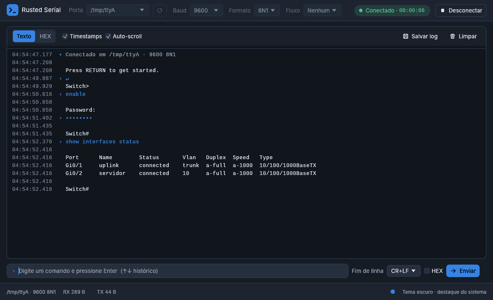

<p align="center">
  
</p>

<h1 align="center">Rusted Serial</h1>

<p align="center">
  Terminal serial nativo, leve e rápido, escrito em Rust.<br>
  Para Arduino, microcontroladores (PIC, AVR, ESP…) e consoles de switches gerenciáveis.
</p>



## Recursos

- **Conexão completa:** porta, baud (300 a 921600), formato (8N1, 7E1…) e controle de fluxo (RTS/CTS, XON/XOFF).
- **Terminal:** horário em cada linha, o que você envia destacado, visão em texto ou HEX, rolagem automática e até 100 mil linhas sem perder velocidade.
- **Envio:** fim de linha configurável (CR, LF, CR+LF), envio em HEX (`AA 01 FF`) e histórico com ↑ ↓.
- **Senhas protegidas:** quando o dispositivo pede `Password:`, o que você digita não aparece na tela, não entra no histórico e é salvo como `[senha oculta]` no log.
- **Log:** salva a sessão em `~/rusted-serial-AAAAMMDD-HHMMSS.log`, legível só pelo seu usuário.
- **Cara de nativo:** segue o modo claro/escuro, a cor de destaque e as fontes do sistema (GNOME, KDE e Windows).
- **Portas virtuais:** aceita qualquer caminho em *Porta → Outra porta…* (`/dev/pts/3`, `/dev/rfcomm0`, `COM10`).

## Instalação

O único requisito comum é o **Rust 1.95 ou mais novo** (exigência do egui 0.37).
Em qualquer sistema, o caminho mais simples é o [rustup](https://rustup.rs). Distribuições
com Rust recente no repositório (Fedora, Arch, openSUSE Tumbleweed) também podem usar o pacote.

Os executáveis de Linux e Windows também ficam disponíveis em cada execução do CI
(aba **Actions** → execução → **Artifacts**).

### Linux

No Linux, além do Rust, é preciso a `libudev` (para listar as portas) e o `pkg-config`.

#### Fedora

```bash
sudo dnf install rust cargo gcc systemd-devel   # systemd-devel traz a libudev
```

#### Debian, Ubuntu e derivados (Mint, Pop!_OS…)

```bash
sudo apt install build-essential pkg-config libudev-dev curl
curl --proto '=https' --tlsv1.2 -sSf https://sh.rustup.rs | sh
```

O pacote `rustc` do apt costuma ser mais antigo que o 1.95, por isso o rustup.

#### Arch Linux e Manjaro

```bash
sudo pacman -S --needed base-devel rust   # a libudev já vem no systemd-libs
```

#### openSUSE

```bash
sudo zypper install gcc pkg-config 'pkgconfig(libudev)'
sudo zypper install rust   # Tumbleweed; no Leap, prefira o rustup
```

#### Permissão para usar as portas

As portas seriais pertencem a um grupo do sistema. Entre nele e depois **saia e entre de novo
na sessão**:

| Distribuição | Comando |
|---|---|
| Fedora, Debian, Ubuntu, openSUSE | `sudo usermod -aG dialout $USER` |
| Arch, Manjaro | `sudo usermod -aG uucp $USER` |

Na dúvida, `ls -l /dev/ttyUSB0` mostra qual é o grupo dono da porta.

> Se um Arduino conectado em `/dev/ttyACM*` reinicia ou mostra lixo logo ao plugar, é o
> ModemManager sondando a porta. Se você não usa modem 3G/4G:
> `sudo systemctl disable --now ModemManager`.

### Windows

1. Instale o Rust: `winget install Rustlang.Rustup` ou baixe o instalador em [rustup.rs](https://rustup.rs).
2. O Rust no Windows precisa das ferramentas de compilação C++ da Microsoft. O instalador
   do rustup oferece instalá-las sozinho; se não oferecer, instale o
   [Build Tools for Visual Studio](https://visualstudio.microsoft.com/visual-cpp-build-tools/)
   com a carga de trabalho **Desenvolvimento para desktop com C++**.
3. No PowerShell, dentro da pasta do projeto: `cargo run --release`.

As portas aparecem como `COM3`, `COM4`… (veja em *Gerenciador de Dispositivos → Portas (COM e LPT)*).
Adaptadores baratos com chip CH340 às vezes precisam do driver do fabricante.

### macOS

```bash
xcode-select --install   # ferramentas de linha de comando (linker)
curl --proto '=https' --tlsv1.2 -sSf https://sh.rustup.rs | sh
```

Cada porta aparece duas vezes: use a `/dev/cu.*` (ex.: `/dev/cu.usbserial-1410`,
`/dev/cu.usbmodem14101`). A `/dev/tty.*` fica esperando o sinal de portadora (DCD) e pode
não conectar.

> **Suporte experimental:** o macOS ainda não é compilado no CI nem foi testado num Mac.
> O código foi escrito para funcionar lá (modo claro/escuro e fontes do sistema), mas a cor
> de destaque do sistema ainda não é lida: o app usa o laranja padrão.

## Compilar e rodar

```bash
cargo run --release
```

O executável fica em `target/release/rusted-serial` (`rusted-serial.exe` no Windows).

### Como as portas aparecem

| Sistema | Exemplos |
|---|---|
| Linux | `/dev/ttyUSB0` (adaptador USB-serial, cabo console), `/dev/ttyACM0` (Arduino Uno/Leonardo), `/dev/ttyS0` (porta serial da placa-mãe) |
| Windows | `COM3`, `COM4`… |
| macOS | `/dev/cu.usbserial-…`, `/dev/cu.usbmodem…` |

## Testar sem hardware

Crie um par de portas virtuais ligadas entre si (Linux e macOS):

```bash
# instale o socat: dnf / apt / pacman / zypper install socat — no macOS: brew install socat
socat -d -d pty,raw,echo=0,link=/tmp/ttyA pty,raw,echo=0,link=/tmp/ttyB
```

No app, use *Porta → Outra porta…* → `/tmp/ttyA`. O que for escrito em `/tmp/ttyB`
(por exemplo `echo "olá" > /tmp/ttyB`) aparece no terminal.

No Windows, o equivalente é criar um par de portas COM virtuais com o
[com0com](https://com0com.sourceforge.net).

## Estrutura

| Arquivo | O que faz |
|---|---|
| `src/serial.rs` | Conexão com a porta numa thread própria, que nunca bloqueia a interface |
| `src/app.rs` | Interface (egui) |
| `src/icons.rs` | Ícones vetoriais |
| `src/system.rs` | Lê tema, cor de destaque e fontes do sistema (uma vez, ao iniciar) |
| `src/theme.rs` | Paleta tingida com a cor de destaque, com contraste mínimo garantido |
| `src/fonts.rs` | Carrega as fontes do sistema |

## Créditos

Ícone do projeto: “Laptop” by [Delapouite](https://delapouite.com) under [CC BY 3.0](http://creativecommons.org/licenses/by/3.0/),
obtido e personalizado em [game-icons.net](https://game-icons.net).

## Licença

[MIT](LICENSE)
